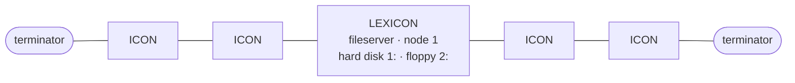

# How the ICON Boots Over the Network: What the Book Says

**Short answer:** *The Book of ICON* has **no description of a boot ROM or of the network boot process**. It is a user's guide. The book gives scattered clues, collected below with page links into [book_of_icon.md](book_of_icon.md) (PDF page − 20 = printed page). Section 2 is clearly marked inference.

## 1. Evidence in the book

### Hardware (spec appendix, [p158–159](book_of_icon.md#p158))

| Item | Value |
|---|---|
| CPU | Intel iAPX186 (80186), 16-bit, 7.2 MHz |
| RAM | 384 KB, expandable to 512 KB on board, plus 896 KB external |
| **ROM** | **Up to 128 KB** |
| **EEPROM** | **32 bytes** |
| Network | "Modified ARCNET", 2.5 Mbit/s token passing, over coax |
| Variants | **Networking ICON** (no disk) or **stand-alone ICON** (floppy drive in the pedestal) |

### Network topology ([p22](book_of_icon.md#p22))

- The LEXICON has two coax sockets. ICONs **daisy-chain** in both directions from it, since each ICON has two network sockets.
- Every unused socket needs a **terminator**, so a correct system has exactly two.
- The glossary calls the network **ICONET** ([p157](book_of_icon.md#p157)).



### Power-on sequence ([p22](book_of_icon.md#p22), [p26](book_of_icon.md#p26))

1. The **LEXICON is switched on first**. The book assumes it is already running before you touch an ICON.
2. Switch on the ICON (amber toggle on the pedestal) and the monitor.
3. A **"weird pattern"** appears on screen, then **numbers**, and then the screen clears.
4. The ICON logo appears with a copyright line (**© 1983 CEMCORP, "VERSION 1"**), a date and time, and `Login:` (Figure 1.4, [p26](book_of_icon.md#p26)).

### Software clues

| Clue | Where |
|---|---|
| A **`/boot`** directory exists on the LEXICON's disk. The backup script saves it first, on the same diskette as `/cmds` | [p41](book_of_icon.md#p41) |
| Commands carry a **node number** prefix: `[1] fdformat 2` runs on node 1. The book says "do not worry about this" | [p43](book_of_icon.md#p43) |
| An older release used **`rmtshell`** (remote shell) for the same job | [p17](book_of_icon.md#p17) |
| Languages are **downloaded** from the fileserver into the ICON's RAM. The LEXICON's light flashes while BASIC loads | [p53](book_of_icon.md#p53), [p156](book_of_icon.md#p156) |
| **`attach` / `detach`** in `/util` set up the system "when it first arrives, or when new user stations are added" | [p62](book_of_icon.md#p62) |
| The OS release on the author's system was **QNX 1.13**, with mentions of 2.0 and 2.1 (`/rel_1.13_info`) | [p61](book_of_icon.md#p61) |
| Sometimes the hard disk has to be re-initialized and the system reloaded from the backup diskettes | [p45](book_of_icon.md#p45) |

## 2. Likely boot sequence (inference, not from the book)

> ⚠️ This is my reconstruction from the clues above and from how diskless QNX/ARCNET workstations of that era generally worked. Treat every step as a hypothesis to check against ROM dumps, disk images, or CEMCORP technical documentation.

```mermaid
sequenceDiagram
    participant ROM as ICON boot ROM (≤128 KB)
    participant EE as ICON EEPROM (32 B)
    participant NET as ARCNET (coax)
    participant LEX as LEXICON (node 1)
    Note over ROM: Power on → 80186 starts in ROM
    ROM->>ROM: Self-test, init video ("weird pattern" = uninitialised screen RAM?)
    ROM->>EE: Read station config (node ID? options?)
    ROM->>NET: Join token ring, request boot image
    NET->>LEX: Boot request from node N
    LEX->>LEX: Look up image in /boot (configured via attach?)
    LEX-->>NET: Send QNX kernel / boot image in blocks
    NET-->>ROM: ("numbers" on screen = progress / node info?)
    ROM->>ROM: Jump to loaded QNX image
    Note over ROM,LEX: QNX now running on ICON; filesystem is the LEXICON's 1: over the network
    ROM-->>LEX: Load login, shell, commands from /cmds on demand
    Note over ROM: Logo + version + date shown, then Login:
```

Why each step is plausible:

- **Diskless station + 128 KB ROM:** a networking ICON has no disk, so whatever runs first has to come from ROM, and the OS has to come over the wire.
- **`/boot` on the server:** this is the natural home for the image the stations download. Its being backed up first, alongside `/cmds`, fits it being needed to restore a working system.
- **32-byte EEPROM:** this is too small for code. It is a good fit for a station's node address and a few settings. ARCNET needs a unique node ID per station.
- **`attach` / `detach`:** these probably register a station's node with the server, which may decide which boot image it gets.
- **The date/time on the logo screen:** a networked ICON may not have its own clock, so it likely gets the time from the LEXICON during boot.
- **LEXICON first:** it has to be up before any station can boot from it.

## 3. What would answer this for real

1. **A LEXICON disk image:** list the contents of `/boot`, and look at `/config` and anything that `attach` writes.
2. **A dump of the ICON boot ROM:** look for ARCNET controller setup and a boot-request routine. The strings may include the copyright text shown on the logo screen.
3. **QNX 1.x / 2.x network documentation:** Quantum Software Systems' documentation on network nodes, the `[n]` prefix and network boot.
4. **CEMCORP technical manuals and *ICONOPHILE*:** the book points to *ICONOPHILE*, CEMCORP's newsletter for ICON users, for updates ([p17](book_of_icon.md#p17)), and refers readers to the "technical documentation supplied with the ICON" ([p15](book_of_icon.md#p15)).
