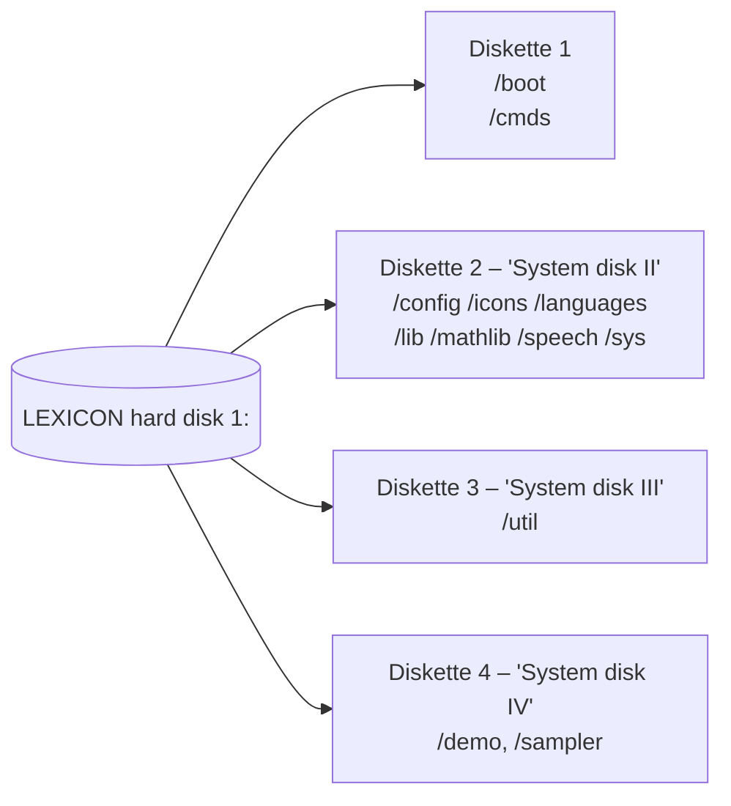
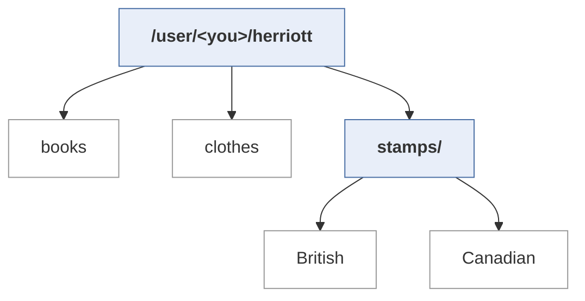
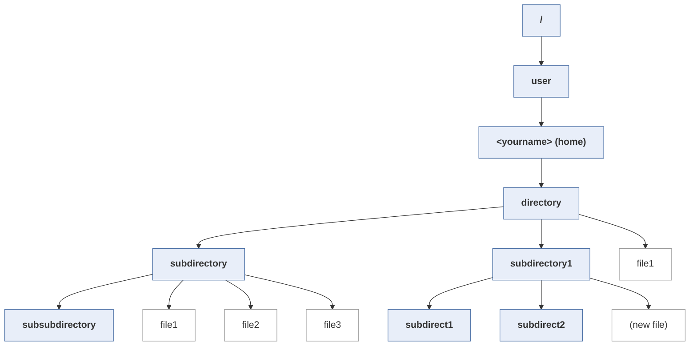

# ICON / LEXICON Disk Layout and Directory Trees

New diagrams built from facts in *The Book of ICON*; they are not copies of the book's figures. Page links go to [book_of_icon.md](book_of_icon.md) (PDF page − 20 = printed page). The diagrams use [Mermaid](https://mermaid.js.org/), which displays in GitHub, VS Code (with a Mermaid extension) and Obsidian.

## 1. Drives

| Drive | Device | Size | Notes |
|---|---|---|---|
| `1:` | LEXICON hard disk | 10 MB | Holds the whole system and all user files. Paths with no drive prefix mean `1:` ([p24](book_of_icon.md#p24), [p63](book_of_icon.md#p63)) |
| `2:` | LEXICON floppy drive (or the pedestal drive on a stand-alone ICON) | 640 KB (DS/DD, 96 tpi). 48 tpi disks give 320 KB | After `[1] dinit 2` an empty disk shows only `2:/bitmap` and **1276 free blocks**, which works out to about 512-byte blocks ([p43–44](book_of_icon.md#p43)) |

**ISSSW 3.x/4.x additions** (official manuals; see [manual_notes/](manual_notes/) and [ICON_qnx2_filesystem.md](ICON_qnx2_filesystem.md)):

| Drive | Meaning |
|---|---|
| `1:` | Fileserver hard disk: the whole 10 MB disk, or partition 1 of a 64 MB disk |
| `2:` | Fileserver floppy: 640 KB default (80×2×8×512); 800 KB with 10 sectors per track |
| `3:` | **Second 32 MB partition** of a 64 MB fileserver. The default search order is `1 3` |
| `5:` | A solo workstation's own floppy (`/drivers/ws_floppy`) |
| `8:` | RAM disk (`mount ramdisk 8 s=128k`) |
| `A:`–`F:` | QDOS DOS drives |

Workstations see the fileserver's drives 1–3 as their own, mounted as `remdisk` at boot. Blocks are **exactly 512 bytes**, and the 1276 free blocks on a 1280-block floppy means 4 blocks of overhead.

A networked ICON has **no disk of its own**. Everything it loads comes from the LEXICON over the network ([p22](book_of_icon.md#p22), [p159](book_of_icon.md#p159)).

## 2. Root of the LEXICON hard disk

```mermaid
graph TD
    root["/ (root, drive 1:)"]
    root --> boot["/boot"]
    root --> cmds["/cmds<br/><i>shell commands:<br/>copy, sort, files, mkdir,<br/>p, frel, drel, cat, ...</i>"]
    root --> config["/config<br/><i>pass (password file)</i>"]
    root --> util["/util<br/><i>ied, ui, vcd, attach, detach,<br/>new_user, sysback, ...</i>"]
    root --> lib["/lib<br/><i>support libraries</i>"]
    root --> mathlib["/mathlib"]
    root --> icons["/icons<br/><i>bitmap icons as hex<br/>(briefcase, ...)</i>"]
    root --> languages["/languages<br/><i>BASIC, Pascal, Logo, ...</i>"]
    root --> speech["/speech"]
    root --> sys["/sys"]
    root --> spool["/spool"]
    spool --> par["parallel"]
    spool --> ser["serial"]
    root --> demo["/demo<br/><i>sayer, line.bw, line.pack,<br/>line.color, hanoi</i>"]
    root --> sampler["/sampler<br/><i>public-domain programs<br/>(author's convention)</i>"]
    root --> rel["/rel_1.13_info<br/><i>release notes, QNX 1.13</i>"]
    root --> user["/user"]
    user --> uicon["icon<br/><i>general-user login</i>"]
    user --> udemo["demo"]
    user --> uname["&lt;login name&gt; ...<br/><i>one per user</i>"]
```



Sources: root walkthrough [p61–62](book_of_icon.md#p61); directories backed up by `sysback` [p41–42](book_of_icon.md#p41); `/config/pass` [p35](book_of_icon.md#p35); `/util` contents [p62](book_of_icon.md#p62).

- **`/user/demo` vs `/demo`:** the book uses both. `cd /demo` at [p28](book_of_icon.md#p28), but `wmi` later prints `/user/demo` ([p48](book_of_icon.md#p48)). Check this against a real disk image.
- **`/boot`:** the book names this directory but never says what's in it. See [the boot notes](ICON_boot_and_network.md).

## 2b. Root of an ISSSW 3.00 fileserver (official tree)

"When the system software is installed, the fileserver contains 11 main directories" (System Software Operations Guide p18). `/lib`, `/mathlib`, `/languages`, `/speech`, `/demo` and `/sampler` from the 1.13 book are not in the official 3.00 list.

```mermaid
graph TD
    r["/"] --> boot["/boot<br/><i>ws_boot, hd_boot, fs_net_boot</i>"]
    r --> cmds["/cmds<br/><i>Quantum QNX commands</i>"]
    r --> util["/util<br/><i>Unisys commands: edit, house,<br/>print, new_user, ...</i>"]
    r --> ucmds["/user_cmds<br/><i>site-written commands</i>"]
    r --> config["/config<br/><i>pass, sys.init, net.config,<br/>u_sys.init.&lt;hex node&gt;, print/</i>"]
    r --> drivers["/drivers<br/><i>ws_floppy, hd, fd, ramdisk</i>"]
    r --> fonts["/fonts"]
    r --> icons["/icons"]
    r --> sys["/sys<br/><i>bootsnd, bootrec, win_mgr,<br/>set_cache, set_rtc, speech, ...</i>"]
    r --> tmp["/tmp"]
    r --> user["/user/&lt;login&gt;<br/><i>.login</i>"]
    r --> spool["/spool<br/><i>parallel, serial</i>"]
    r --> bitmap["bitmap<br/><i>(file: block allocation map)</i>"]
```



Reinstalling keeps `/config/pass`, `net.config`, `/user_cmds`, `/config/print` and the `user_*_sys.init` files. Back up `bad_blocks` along with them.

## 3. The system backup set (`sysback`)

The book's backup command file spreads the system directories over **4 formatted diskettes** ([p40–42](book_of_icon.md#p40)). Each one is prepared with `[1] dinit 2`, then filled with `backup /dir 2:/dir +a +d +o`.



The book notes that you sometimes have to re-initialize the hard disk and reload the system from these diskettes ([p45](book_of_icon.md#p45)). Diskette 1 (`/boot` + `/cmds`) is the minimum you need to bring a system back.

## 4. A user's "family tree" (home directory)

### 4a. The Chapter 4 exercise ([p48–52](book_of_icon.md#p48))



### 4b. The Chapter 5 tree, as browsed with `vcd` / `ui` ([p57–65](book_of_icon.md#p57))



Path of the deepest node: `1:/user/<yourname>/directory/subdirectory/subsubdirectory`.

**How `vcd` draws this:** it stacks the path as boxes down the left side, with the root `/` at the top, then `user`, then your name, and so on. The current directory is shown in reverse video. Below it, up to **7** children hang on lines; directories appear in boxes and plain files without. If there are more than seven, you page with a right-arrow box ("1 of n sets"). The bottom line shows the path so far, and a *RETURN TO SHELL* box exits ([p59–61](book_of_icon.md#p59)).

**How `ui` shows the same tree:** directories are **doors** and files are **notebooks**. A blank door or notebook creates a new directory or file. The open door goes up a level (`cd ^`), the house goes home (`cd`), and the key exits. The *QNX* icon drops you to a shell, and the briefcase moves files ([p63–68](book_of_icon.md#p63)).

## 5. Path syntax quick reference

```
1:/user/jones/letters      drive 1 (hard disk), absolute path
2:/jones                   drive 2 (floppy)
[1] cmd                    run cmd on network node 1 (the LEXICON)
/user/<login>              a user's home directory
```
